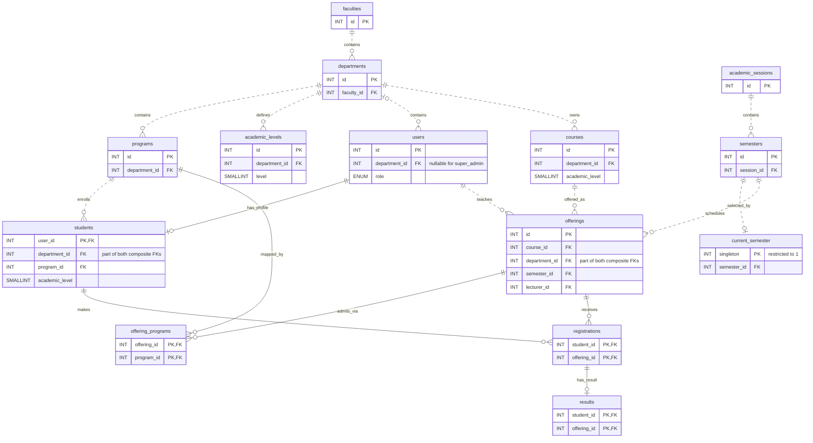

# Database design

This diagram covers the academic tables defined in [001_schema.sql](../database/001_schema.sql) and migrations [003](../database/003_offering_programs.sql), [005](../database/005_result_workflow.sql), and [006](../database/006_management.sql). Lecturer profiles are rows in `users` with `role = 'lecturer'`.

**Registration and result.** `registrations.student_id` references `students.user_id`, and `registrations.offering_id` references `offerings.id`. The exact duplicate guard is `PRIMARY KEY (student_id, offering_id)` on `registrations`. A result references that pair through `FOREIGN KEY (student_id, offering_id) REFERENCES registrations(student_id, offering_id)`. The pair is also the primary key of `results`, so each registration can have zero or one result. `UNIQUE (course_id, semester_id)` on `offerings` allows one offering per course per semester.

**Database enforcement.** Every line represents a foreign key. On `students`, the pairs `(user_id, department_id)` and `(program_id, department_id)` reference `users(id, department_id)` and `programs(id, department_id)`. On `offerings`, `(course_id, department_id)` and `(lecturer_id, department_id)` reference `courses(id, department_id)` and `users(id, department_id)`. These composite keys enforce department alignment. Dashed lines denote non-identifying relationships.

**PHP enforcement.** The database checks account existence and department membership through those keys. PHP checks that a student profile belongs to a student account, a lecturer assignment targets a lecturer account, and an offering's mapped programs belong to the same department. The `academic_level` values on `students` and `courses` have no foreign key to `academic_levels`. The [management handlers](../app/manage.php) validate levels and scoped choices, and [registration](../app/registration.php) checks that the active student's department, program, and level match an offering in the current semester.
